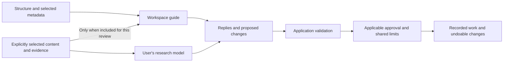

# ros.ai inference design · October 1, 2026

**October 2 implementation status:** response capture, compatible HTTP connection registration, independent Research model/Workspace guide selection and explicitly scoped guide reviews are implemented. [Setup](inference-setup.md) and [RESULT](../RESULT.md) distinguish application enforcement from declared endpoint capabilities and verification evidence. Optional managed Nemotron download/runtime, actual laptop evaluation, additional CLI protocols and conditional fine-tuning remain later delivery stages.

**Original October 1 status: proposed design, with user-confirmed hardware and default context.** The design below records the intended architecture and candidate choices at that date. No runtime, grants, model files or training jobs were changed during that design turn.

## Direction and constraints

The user wants a trusted personal API, CLI connection or local model for research, while ros.ai provides its own model to help with decisions, conclusions, workspace structure and explicit node inputs and outputs. The confirmed first target is ordinary laptops, including Mac, through an optional model download. The guide defaults to workspace structure and selected metadata; private content is included only explicitly.

Recommendations below remain proposals: one assistant with explicit guide reviews, a quantized Nemotron base model before fine-tuning, a server-owned connection registry, and no silent cloud fallback. The exact checkpoint, hardware floor, performance target, training budget and release package are unsettled.

## Two roles; independent connection choices

| Role | Purpose | Context | Processing choice |
| --- | --- | --- | --- |
| Research model | Investigate questions, analyze evidence and propose research work | Authorized research context | User's API, supported CLI or local model |
| Workspace guide | Suggest organization, clarify relationships, propose input/output selections and review conclusions | Structure, selected metadata, and explicitly included evidence | ros.ai's optional local Nemotron; external guidance would require explicit setup and context consent |

A role describes the task. A connection describes how and where inference runs. The same backend may serve either role, but each request retains its own context selection and authority. Maker, provider and role are separate: NVIDIA Nemotron hosted by Nebius is external inference; Nemotron in a verified local runtime is local inference.

The guide can suggest structure from the question and metadata the user includes. It cannot assess a research conclusion from a graph alone. A conclusion review needs selected evidence, distinguishes measured results, source claims and model interpretations, and identifies gaps with exact evidence references. Guide judgments remain model interpretations.

## Compact product surface

Keep the assistant's main picker for the Research model, showing maker symbol, model and destination. Add **Review workspace**, with **Structure**, **Inputs and outputs** and **Conclusion** choices. Put guide installation/checkpoint/runtime settings in secondary settings rather than another form above the conversation.

Before a review, show a compact context summary: structure, selected metadata, and any selected private content/evidence. Evidence selection identifies exact versions and exposes excerpts through a disclosure. Each reply names the actual model and **On this computer** or **Sent to [destination]**. Personal keys and locally launched CLIs do not prove local processing.

Do not invoke a second model silently on every message. Guide reviews need Stop and local resource limits. If the guide cannot run, keep manual workspace controls available; changing to an external connection is deliberate.

## Context routing and privacy

Build a separate guide projection before message assembly. Current [assistant context](../src/server/assistant.ts) includes titles, descriptions, question history, chats, memory, evidence, code and diagnostics. Existing agent workspace tools also expose research content. Neither is the guide's default context.

Use explicit scopes:

1. **Structure:** temporary block aliases, kinds, containment, topology, and enumerated status/UI intent. Exclude titles, descriptions, URLs, filenames, actual IDs/hashes, free-text relationship labels, chats, artifacts, code and raw errors. Alias mapping stays local.
2. **Selected metadata:** include only selected fields such as particular titles, descriptions or relationship wording. Metadata can be private; it is not presumed public.
3. **Selected content:** include chosen notes or exact artifact versions/excerpts. Summaries and derived outputs inherit their source material's routing restrictions. Previous research replies are not automatically forwarded.

Capture an immutable request manifest with destination, selected fields/versions, hashes and omissions. Structural presets use public intents instead of copying the latest research prompt. Free text addressed to the guide is deliberate content inclusion and is disclosed. Focus, grouping, relationships and spending consent never broaden scope. Evidence aliases resolve to captured versions locally; additional evidence requires explicit inclusion.

Private material goes only to the selected destination. The local guide needs no general filesystem access, research tools or unrestricted network. Its verified runtime receives the assembled request and permitted model files, with no cloud fallback, external retrieval, context-bearing telemetry or permission-changing tools. An externally managed localhost endpoint with unverified processing location must show that uncertainty; a loopback URL alone does not prove privacy.

## Node inputs, outputs and decisions

Keep exploratory semantics. Groups organize; relationships describe meaning; Node inputs select saved evidence versions; Node outputs are captured artifacts. Connections neither schedule another node nor import its source's latest result.

The guide may propose blocks, grouping, relationship wording, selection of a particular output as another node's input, or missing-evidence warnings. The application resolves aliases, validates versions/revisions and checks authority under the selected approval mode. **Ask** requires approval of the specific change. Additional Actions inherit shared limits and never replenish them.

Example: a trusted local Research model analyzes a private company table and saves result A. The guide initially receives only structure and selected labels. To ask whether the conclusion follows from the figures, the user includes exact table/result A. The review cites A. Applying a conclusion or selecting A as another node's input is a separate validated change and does not run downstream work.

## Response protocol

The October 1 **What can you do** request failed because the direct-model path required JSON before retaining the reply and usage. The raw provider reply is absent, so plain text, malformed JSON and truncation cannot be distinguished retrospectively. This integration defect needs a protocol fix independently of checkpoint training.

Separate **reply text**, **candidate actions**, and **completion evidence**. Preserve bounded visible provider responses, reported usage, finish reason and model metadata before validating actions. Adapters normalize transport; the application validates proposals. Captured evidence is not hidden reasoning or a promise of deterministic replay.

Use structured output/tool calls where supported. Text-only models can still answer ordinary questions; candidate actions need explicit extraction and strict validation. Invalid action format preserves any identifiable conversation reply and diagnostics while applying no changes. Never execute partial/guessed actions or automatically repeat paid requests to repair formatting. A user-triggered repair is another accounted request. Missing usage remains uncertain rather than zero.

## Minimal connection architecture

Extend existing seams rather than build a universal agent framework:

- A server-owned registry resolves stable connection/model IDs to [ModelAdapter](../src/server/providers.ts). Endpoint/auth references remain server-side. Declared capabilities and verified enforcement remain distinct.
- A coordinator handles context selection, admission, cancellation, response capture and application validation. The guide projection is separate from research message assembly.
- Replace fixed provider/model validation in [model-settings.ts](../src/server/model-settings.ts) and the direct adapter switch in [execution.ts](../src/server/execution.ts) with registry resolution. Preserve existing grant IDs, reservations, defaults, node overrides and ownership inheritance. Migration/connection changes must not reset cumulative usage.
- Add configured user-owned HTTP inference first, including compatible local endpoints. Record context/output caps, response/tool support, cancellation, pricing basis and processing destination. Different protocols need concrete adapters; compatibility is not inferred from branding.
- Add supported CLI protocols separately. Completion-only CLIs need bounded input, output/time limits and cancellation. Complete coding agents remain behind [AgentRuntime](../src/shared/agent-runtime.ts), with verified read isolation and bounded tools. A model selector must not expose arbitrary shell execution or unconstrained host access.

Authentication, destination, context permission, action authority and usage budget are independent. Unknown remote pricing requires an enforceable conservative cost basis before dispatch, not a zero-cost assumption. Subscription agents retain explicit turn/time/tool limits and honestly unknown dollar cost. Local inference uses verified runtime/resource limits, context/output caps, initially one guide review at a time, a deadline and Stop; it does not debit provider USD merely for running locally. Resource access does not grant edits or external calls.

## Nemotron candidate and adaptation

**Candidate, not a verified package:** NVIDIA's [Nemotron 3 Nano 4B Q4_K_M GGUF](https://huggingface.co/nvidia/NVIDIA-Nemotron-3-Nano-4B-GGUF) has documented llama.cpp deployment. [llama.cpp](https://github.com/ggml-org/llama.cpp) supports Apple Silicon through Metal and CPU execution. This justifies evaluating the combination, not claiming latency, RAM requirements or correct behavior on every laptop.

Recommend an optional versioned download with pinned model revision, runtime version, hash, template, quantization and notices. Keep installation separate from project data, avoid downloads on ordinary startup and verify offline operation after installation. Benchmark modest context sizes on target laptops before claiming a hardware floor. Lower-memory machines may need a smaller candidate. The model card lists English support; Dutch and Chinese guidance need measured language checks.

Start with the base model, explicit workspace instructions and validated schemas. Fine-tune only for repeatable shortcomings. Train **workspace behavior**: concise structure, valid block references, explicit input/output reuse, grounded reviews and recognition of missing evidence. Use public, synthetic or specifically consented data with provenance; never private projects by default. Hold out evaluation tasks and compare base/adapted models at equal context/output settings.

NVIDIA supplies [SFT/LoRA recipes for the 4B model](https://docs.nvidia.com/nemo/automodel/model-coverage/large-language-models/nvidia/NVIDIA-Nemotron-3-Nano-4B-BF16). Targeted LoRA followed by compatible export/quantization is the proposed path, subject to tool/runtime validation. This is adaptation of an existing model, not foundation-model training. GPU needs, conversion quality and cost remain unmeasured; Nebius AI Cloud training requires a separate bounded budget.

The [NVIDIA Nemotron Open Model License](https://www.nvidia.com/en-us/agreements/enterprise-software/nvidia-nemotron-open-model-license/) allows derivative works and redistribution subject to conditions. A release must carry applicable license/notices, retain relevant source attribution and meet included NOTICE requirements. Runtime and dataset licenses also need recording; this proposal is not a completed redistribution review.

## Delivery order and evidence

1. Fix response capture and reply/action separation, preserving usage on invalid proposals.
2. Add registry/context routing, migrate without resetting limits, then verify one real local HTTP adapter with model/location/scope disclosure.
3. Evaluate optional local Nemotron guidance: explicit review, structural default, metadata/content opt-in, actual laptop behavior and offline/Stop checks.
4. Adapt only if held-out tasks improve; package the selected model with provenance and notices.

Measure valid actions/references, correct evidence versions, grounded conclusions, omission/conflict handling, scope-expansion attempts, privacy routing, memory, latency and cancellation. Use small task-specific evaluations, including malformed actions and untrusted evidence, rather than broad defensive suites. Compare the deployed quantization with the evaluation checkpoint. Model compliance measures quality; application checks enforce authority.

The [official hackathon criteria](https://nebiusglobalaihackathon.devpost.com/rules) assess effective use of Nebius Token Factory or AI Cloud and NVIDIA Nemotron or other NVIDIA open models, alongside design, impact and idea quality. Fine-tuning is not listed as mandatory. A possible demonstration is consented/synthetic adaptation on Nebius with measured local guidance, or explicitly scoped hosted Nemotron research. This is an option, not eligibility, completed cloud use or spending authorization. Event preparation stays in the existing Inbox checklist.

Reviewed against current code seams and official sources on October 1. No model download/run, training, paid inference, subscription CLI turn, installation, runtime/UI edit, deployment or grant change occurred for this design. Build/browser checks await runtime changes; earlier receipts stay historical. [CONTEXT.md](../CONTEXT.md) contains shared terms; [RESULT.md](../RESULT.md) records the preceding implemented iteration, not this proposed capability.
